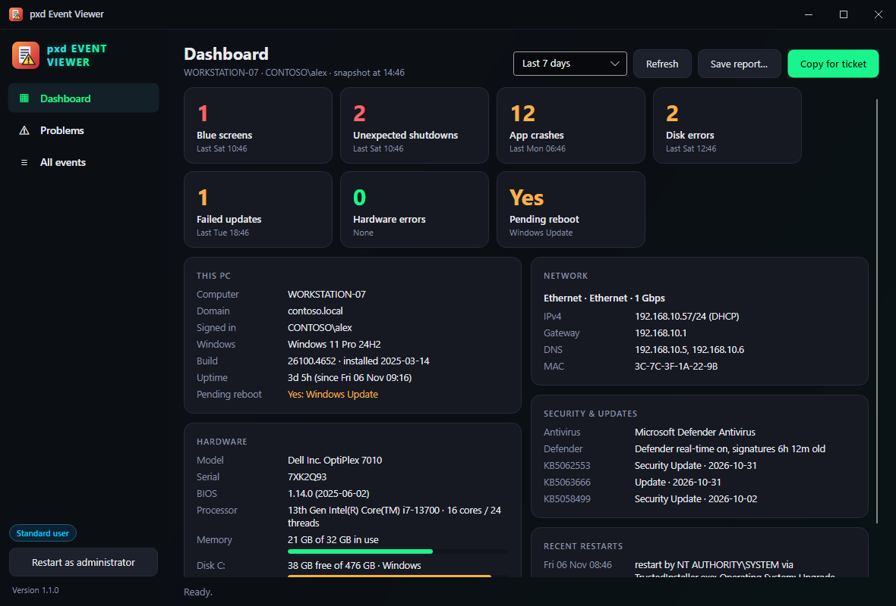
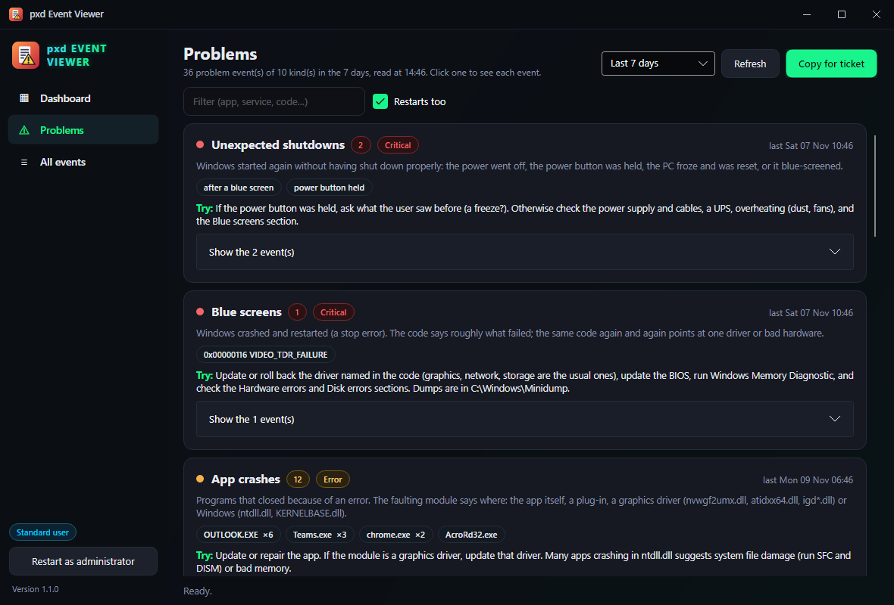
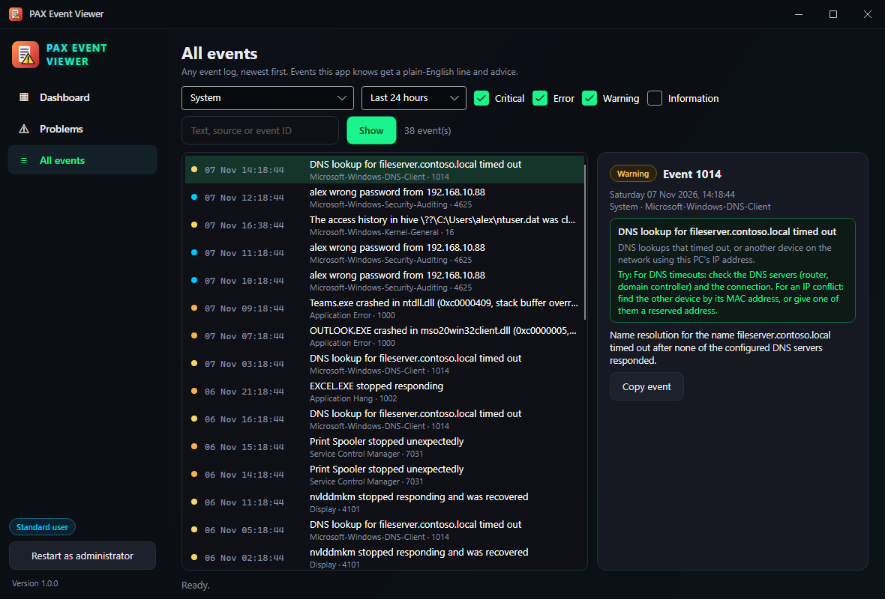

# pxd Event Viewer

A dashboard with everything a support ticket needs (PC, Windows, uptime, pending reboot, disks, network, antivirus, updates) and a digest of the event logs that turns blue screens, crashes, disk errors, failed updates and the rest into one line each, with what to try next.

<p align="center">
  
</p>

## Features

- **Dashboard: the PC snapshot.** Computer name, domain or workgroup, signed-in user, Windows edition, version and build, install date, **uptime and last boot**, **pending reboot and why** (Windows Update, servicing, file renames, a rename), make, model and serial, BIOS, processor, memory in use, **free space per drive**, every connected adapter with IP, gateway, DNS, DHCP or static and MAC, antivirus and Defender signature age, the latest installed updates, and recent restarts with who caused them.
- **Health tiles** for the chosen period (last 24 hours, 7 days or 30 days): blue screens, unexpected shutdowns, app crashes, disk errors, failed updates, hardware errors and pending reboot. Click one to jump to the details.
- **Copy for ticket** puts the snapshot and a problem summary on the clipboard as plain text. **Save report…** writes a self-contained HTML page (or .txt) to attach.
- **Problems: the event log digest.** 18 kinds of trouble, each explained in plain English with **what to try**:
  - Blue screens, with the stop code **named** (0x116 VIDEO_TDR_FAILURE, 0x9F DRIVER_POWER_STATE_FAILURE, …)
  - Unexpected shutdowns, telling apart a power cut, a held power button and a blue screen
  - Hardware (WHEA) errors, drives predicted to fail (SMART), memory test failures
  - Disk and file system errors, drive resets
  - App crashes with the faulting module and exception (`OUTLOOK.EXE crashed in mso20win32client.dll (0xc0000005, access violation)`), and apps that stopped responding
  - Graphics driver resets, service failures, failed Windows updates (with the 0x8… code), failed program installs
  - Low disk space, DNS timeouts and IP conflicts, Group Policy errors, clock sync problems
  - Failed sign-ins with the reason and address (administrator)
  - Restarts and shutdowns: who or what did it, and why
  - Repeats are grouped (`OUTLOOK.EXE ×6`); open a problem to see every event and its full text. Kinds with nothing to report are listed as **all clear**.
- **All events:** browse any log (System, Application, Security, Setup, PowerShell, Task Scheduler, Windows Update, Defender, RDP sessions, boot performance), newest first, filtered by level, period and text or event ID. Events the app knows get the plain-English line and advice next to the full message.
- **Opens as a normal user.** Only the Security log (failed sign-ins) needs administrator rights; **Restart as administrator** in the sidebar adds it.
- **Fast:** the whole 7-day digest takes well under a second on a typical PC, and nothing ever blocks the window.
- **pxd standard:** dark pxd title bar, remembers its window, one copy at a time, installed and kept up to date by **[pxd Toolkit](https://github.com/pxdtek/pxdToolkit)**.

| Problems | All events |
| --- | --- |
|  |  |

## Supported systems

| System | Status | Notes |
| --- | --- | --- |
| Windows 11, x64 | **Tested** | |
| Windows 10, x64 | Should work, untested | Same event logs and WMI classes. |
| Windows Server 2016 and later | Should work, untested | No Security Center, so the antivirus line may say "None reported". |
| Linux, macOS | **Not supported** | Windows event logs only. |

## Install (Windows)

**From pxd Toolkit:** turn on pxd Event Viewer in **[pxd Toolkit](https://github.com/pxdtek/pxdToolkit)** and it's downloaded and kept up to date for you.

**By hand:**

1. Install the **[.NET 10 Runtime](https://dotnet.microsoft.com/download/dotnet/10.0)** (x64) if you don't have it.
2. Download **`pxdEventViewer-1.1.2-win-x64.zip`** from **[the latest release](https://github.com/pxdtek/pxdEventViewer/releases/latest)**.
3. Unzip it somewhere permanent, for example `%USERPROFILE%\Apps\pxdEventViewer`.
4. Run `pxdEventViewer.exe`.

Coming from a version before 1.1.0 (when the app had another name)? The first start moves its saved window settings to `%APPDATA%\pxdEventViewer`.

**Updates itself.** Each time it starts, it checks for a newer release (for at most a few seconds; offline it just opens), swaps in the new files in its own folder and reopens. `--report` runs, the administrator restart and `--self-test` don't check; `PXD_NO_UPDATE=1` turns it off.

The exe isn't code-signed, so SmartScreen may warn the first time: choose **More info → Run anyway**.

## Run it from PowerShell (no install)

The console edition works on any Windows PC with PowerShell, with nothing to download or install:

```powershell
irm pxdtek.com/ev | iex
```

It shows the same PC snapshot and the same plain-English problem digest (all 18 kinds, with what to try), lets you open any problem or event, browse and filter any log, copy ticket text (**T**) and save an HTML, text or JSON report (**R**). It runs in Windows PowerShell 5.1 and PowerShell 7 as a normal user; run it from an elevated prompt (or press **A**) to include failed sign-ins. It never changes anything on the PC.

Non-interactive, for remote shells and scripts:

```powershell
& ([scriptblock]::Create((irm pxdtek.com/ev))) -Report -Days 30
& ([scriptblock]::Create((irm pxdtek.com/ev))) -Export C:\Temp\pc.html
```

`-Ticket` copies the ticket text to the clipboard. The script is [`cli/pxdEventViewer.ps1`](cli/pxdEventViewer.ps1); pxdtek.com serves its raw GitHub copy.

**From a remote PowerShell (admin), without the user seeing anything:** nothing opens on their screen and nothing asks for permission. *Signed in* shows the person at the PC (console and Remote Desktop sign-ins), followed by "report run by" your account.

```powershell
Invoke-Command -ComputerName PC-NAME -ScriptBlock { & ([scriptblock]::Create((irm pxdtek.com/ev))) -Report -Days 7 }
```

Use `-Report` or `-Export` there: `-Ticket` would copy to the remote PC's clipboard.

The console edition never saves anything on the PC unless you ask for a report (**R** or `-Export`), and then only where you choose. When the [pxd Toolkit](https://github.com/pxdtek/pxdToolkit) console runs it with `$env:PXD_INMEMORY = '1'`, it says so at the start ("In-memory: nothing is saved on this PC."), and **A** (restart as administrator) keeps that mode in the new window. `cli\Test-InMemory.ps1` checks this.

## Command line

| Option | What it does |
| --- | --- |
| `--report <file.html\|file.txt> [--days N]` | Writes the snapshot and problem digest (default 7 days) without opening the window. Handy over a remote shell. |
| `--self-test <folder>` | Diagnostics, see below |
| `--self-test <folder> --sample` | The same, with a made-up PC and events in the window, for screenshots |
| `--write-icon <file.ico\|file.png>` | Build step: writes the app icon |

## Self-test

```bat
pxdEventViewer.exe --self-test C:\Temp\pxd-test
```

Writes `report.txt` into that folder. It checks that every rule's query is accepted by Windows, reads recorded example events (blue screens, crashes, service failures, failed updates, sign-ins and more) and checks the plain-English line for each, takes the snapshot and the 7-day digest of this PC (read only) and lists what was found, writes `ticket.txt` and `report.html`, checks window placement and the single-instance hand-off, and saves a picture of every page drawn by Avalonia's headless renderer, so nothing appears on your screen. Without `--sample` the report, ticket and pictures contain this PC's real details. The exit code is 0 when every check passed.
